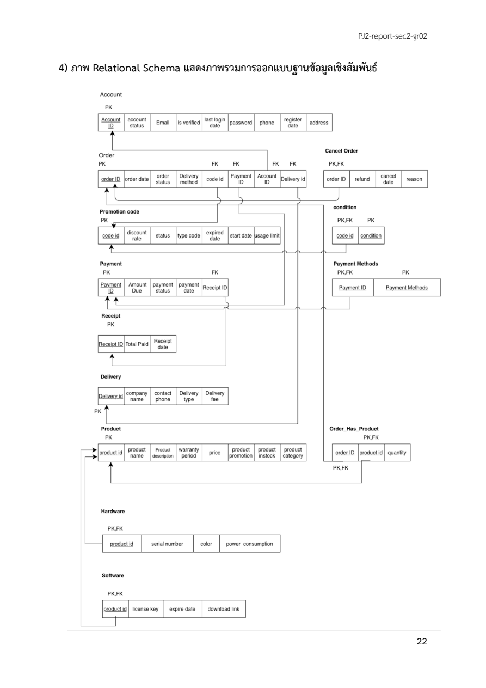

# BaNANA Online - โครงการออกแบบฐานข้อมูล

โครงการวิเคราะห์และออกแบบฐานข้อมูลร้านค้าอุปกรณ์ไอทีออนไลน์ สำหรับวิชา **ITDS221 Database Management Systems, Section 02, Group 02 มหาวิทยาลัยมหิดล** จัดทำเป็นทีม 5 คน โดยใช้ BaNANA Online เป็นกรณีศึกษาทางการศึกษา ไม่มีความเกี่ยวข้องหรือการรับรองจากบริษัท

## ส่วนที่ผมรับผิดชอบ

**รัฐพงศ์ คูสกุลธรรม (Rattapong Koosakultham)**

- ร่วมจัดทำ Context Diagram และ Use Case Narrative
- ร่วมเตรียมงานนำเสนอ รายงานและสไลด์เสร็จแล้ว

เอกสารและแบบจำลองฐานข้อมูลในโครงการเป็นผลงานของทีม

## ขอบเขตโครงการ

วิเคราะห์ความต้องการและออกแบบฐานข้อมูลสำหรับบัญชีลูกค้า สินค้า คำสั่งซื้อ รายการสินค้าในคำสั่งซื้อ รหัสส่วนลด การชำระเงิน ใบเสร็จ การจัดส่ง และการยกเลิกคำสั่งซื้อ

ผลงานประกอบด้วยแบบจำลอง ER/EER การแปลงเป็น Relational Schema การทำ Normalization ถึงระดับ 3NF และพจนานุกรมข้อมูล (Data Dictionary)

**สถานะ:** จัดทำเอกสารและแบบจำลองการออกแบบฐานข้อมูลแล้ว โดยชุดผลงานนี้ยังไม่มีโค้ดแอปพลิเคชัน สคริปต์ SQL สำหรับสร้างฐานข้อมูล ข้อมูลสาธิต หรือชุดทดสอบฐานข้อมูลอัตโนมัติ

## เปิดดูผลงาน

| ผลงาน | ไฟล์ |
| --- | --- |
| รายงานการออกแบบฐานข้อมูล | [PDF](docs/database-design-report.pdf) |
| สไลด์นำเสนอ | [PDF](docs/database-design-slides.pdf) |
| แบบจำลอง EER | [ไฟล์ draw.io ที่แก้ไขได้](diagrams/eer-diagram.drawio) |
| โครงสร้างฐานข้อมูลเชิงสัมพันธ์ | [ไฟล์ draw.io ที่แก้ไขได้](diagrams/relational-schema.drawio) |
| การทำ Normalization ถึงระดับ 3NF | [ไฟล์ draw.io ที่แก้ไขได้](diagrams/normalization-3nf.drawio) / [PDF](docs/normalization-3nf.pdf) |
| พจนานุกรมข้อมูล | [ไฟล์ draw.io ที่แก้ไขได้](diagrams/data-dictionary.drawio) |

เปิด PDF บน GitHub หรือโปรแกรมอ่าน PDF ได้โดยตรง ส่วนไฟล์ `.drawio` เปิดด้วย diagrams.net หรือโปรแกรม draw.io โครงการนี้เป็นชุดเอกสาร จึงไม่ต้องติดตั้งระบบหรือฐานข้อมูลเพื่อเปิดดูผลงาน

## ตัวอย่างผลงาน

## แนวทางการออกแบบ

1. วิเคราะห์กระบวนการทำงาน ความต้องการ และกฎทางธุรกิจ
2. ออกแบบเอนทิตีและความสัมพันธ์ด้วยสัญลักษณ์ ER/EER แบบ Chen
3. แปลงแบบจำลองเชิงแนวคิดเป็นโครงสร้างฐานข้อมูลเชิงสัมพันธ์ตามกระบวนการ 8 ขั้นตอน
4. ตรวจสอบการขึ้นต่อกันของข้อมูลและทำ Normalization ถึงระดับ 3NF
5. กำหนดรายละเอียดแอตทริบิวต์และข้อกำหนดในพจนานุกรมข้อมูล

## สมาชิกทีม

ผลงานและรายงานเป็นของทีม ITDS221 Section 02 Group 02:

- สุรักษ์ งามบุษกรโสภณ
- คฑาเทพ เทพหัสดิน ณ อยุธยา
- ศุภณัฐ แก้วการะเวก
- ภัทร์ธนัชนนท์ สุดถาวรเจริญ
- รัฐพงศ์ คูสกุลธรรม

**ผู้ดูแลผลงานบน GitHub:** [Raymond14725836](https://github.com/Raymond14725836)

## การจัดเตรียมไฟล์สำหรับเผยแพร่

- คัดเลือกไฟล์ฉบับสมบูรณ์จากโฟลเดอร์ `Send2` โดยไม่รวมฉบับร่างและไฟล์สำรอง
- เก็บไฟล์แผนภาพต้นฉบับที่แก้ไขได้ และตั้งชื่อให้สื่อความหมาย
- สำเนา PDF ตัดปกรายงานและหน้าข้อมูลสมาชิกในสไลด์ที่มีรหัสนักศึกษาออก โดยคงเครดิตทีมไว้ด้านบน
- เนื้อหาและเลขหน้าที่พิมพ์ไว้ในส่วนที่เหลือยังคงเดิม ตำแหน่งหน้าใน PDF จึงอาจต่างจากฉบับต้นฉบับ
- ไฟล์ Word, PowerPoint และบทพูดต้นฉบับเก็บไว้นอกโครงการบน GitHub นี้

## ข้อจำกัดและแนวทางพัฒนาต่อ

แบบจำลองในโครงการนี้ยังไม่ได้ตรวจสอบกับฐานข้อมูลที่รันจริง งานที่สามารถพัฒนาต่อได้ ได้แก่ สคริปต์ SQL DDL ข้อมูลตัวอย่าง คำสั่งสืบค้น และชุดทดสอบข้อกำหนดของฐานข้อมูล

## สิทธิ์และแหล่งอ้างอิง

โครงการนี้ยังไม่ได้ให้สิทธิ์ใช้งานแบบโอเพนซอร์ส เอกสารทางการศึกษาเป็นผลงานของผู้จัดทำแต่ละส่วน ชื่อ BaNANA ภาพหน้าจอ และสื่อจากบุคคลภายนอกยังเป็นสิทธิ์ของเจ้าของเดิม โดยเก็บแหล่งอ้างอิงและการเปิดเผยการใช้ Generative AI ตามต้นฉบับไว้ในรายงาน
